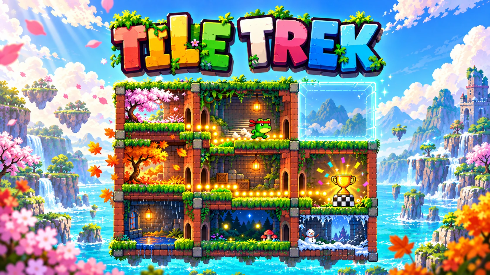
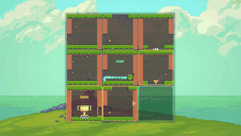
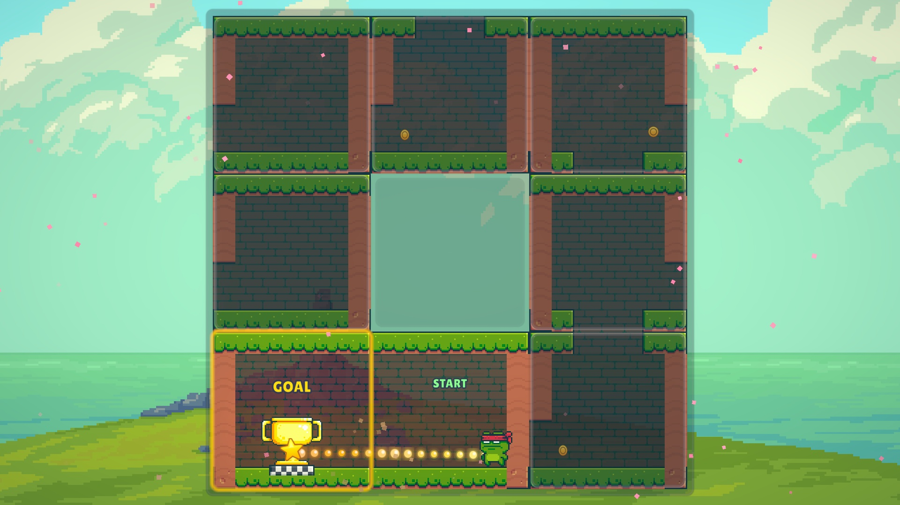
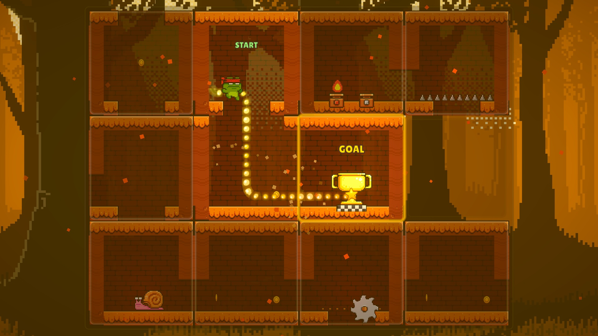
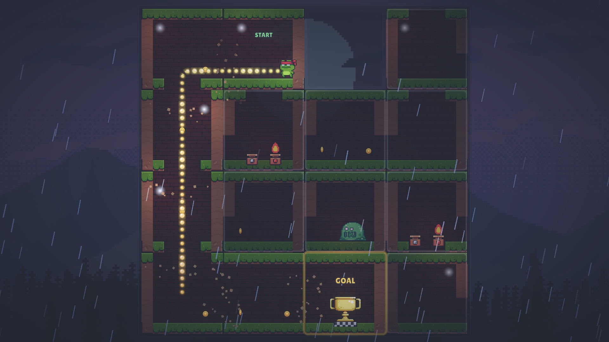
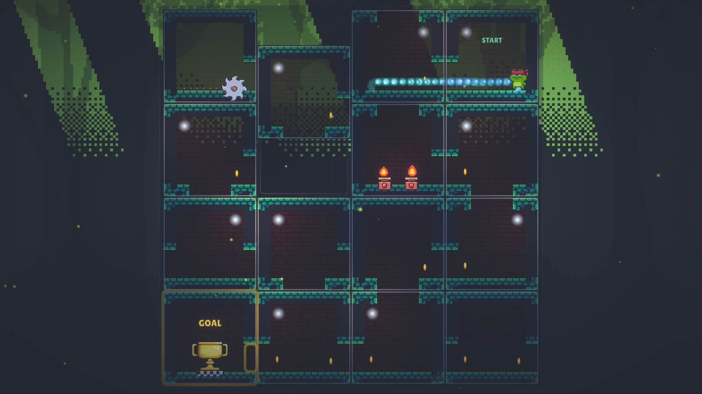
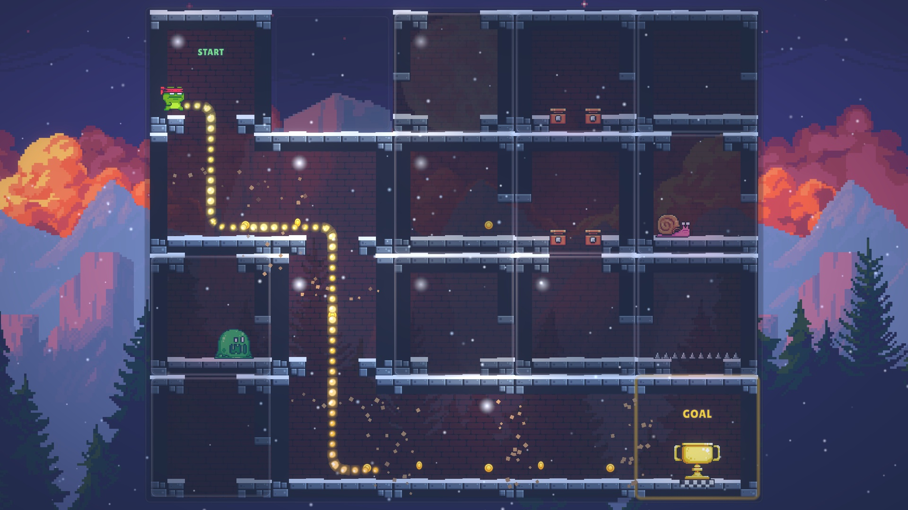

<p align="center">
  
</p>
<p align="center">
  
</p>
<p align="center">
  <a href="https://bluelolipop1.itch.io/tile-trek"></a>
  &nbsp;
  <a href="https://github.com/vishwaMoger/TileTrek/releases/tag/tile-trek-v1"></a>
</p>
<p align="center"><sub>Free in your browser · no download · desktop landscape &amp; phone portrait</sub></p>
<p align="center">
  
  
  
  
  
  
</p>
<p align="center">
   YOUR HERO NEVER STOPS WALKING / > SLIDE THE ROOMS. BUILD THE PATH. / > REACH THE TROPHY!" />
</p>

---

<h2 align="center">🎮 GAMEPLAY</h2>

<p align="center">
  
</p>
<p align="center"><b>Your hero never stops walking. Slide the rooms to build their path to the trophy, live!</b></p>

<p align="center">
  
</p>
<p align="center">
  
</p>

---

<h2 align="center">📸 FIVE SEASONS</h2>

<p align="center">
  
  
  <br/><sub>🌸 Spring Meadow &nbsp;·&nbsp; 🍂 Autumn Woods</sub>
</p>
<p align="center">
  
  
  <br/><sub>🌧️ Rainy Peaks &nbsp;·&nbsp; ✨ Firefly Night</sub>
</p>
<p align="center">
  
</p>
<p align="center"><sub>❄️ Snowy Castle</sub></p>

---

<h2 align="center">🕹️ CONTROLS</h2>

| Action | Keyboard | Touch / mouse |
|---|---|---|
| Slide a room into the gap | Arrow keys / WASD (pushes the neighbour into the gap) | Tap or swipe a highlighted room |
| Pause | Esc or P | Pause button |

Stars per puzzle: ⭐ **solved**, ⭐ **fast** (under the target time), ⭐ **smart** (at or under par slides).

---

<h2 align="center">⚙️ UNDER THE HOOD</h2>

<p align="center">
  
</p>

---

<h2 align="center">🌱 ORIGIN STORY</h2>

<p align="center">Tile Trek was built from <a href="https://github.com/vishwaMoger/FruitQuest"><b>Fruit Quest</b></a>, my pixel platformer (<a href="https://bluelolipop1.itch.io/fruit-quest">play it on itch.io</a>),<br/>which itself grew out of <a href="https://github.com/vishwaMoger/VishwaMoger_MiniPlatformer"><b>Mini Platformer</b></a>.</p>

---

<h2 align="center">🛠️ FOR DEVELOPERS</h2>


<details>
<summary><b>🛠️ For developers: full design notes, code map, dev console and builds</b></summary>

### About


A live sliding-tile puzzle for Unity 6.3 (URP 2D). The level is a grid of small pixel rooms with one empty slot.
Your hero walks on their own: forward, up one-tile ledges, around at walls, down through floor holes. You never
control them. You **slide rooms into the empty slot** (tap, swipe or arrow keys) to build their way to the trophy
in real time, keeping them out of trap rooms (spikes, saws, fire, critters) and away from the void.

- A **route trail** (bead shader) shows where the hero will walk through the rooms you've linked; it turns gold
  and ends in a star when it reaches the trophy, red with a cross when it leads into danger.
- **Cheers** as you get closer: halfway there, almost there, path complete.
- Once the route is complete the rooms **melt into one seamless hall**, the board locks, and the hero runs home.
- Stars per puzzle: **solved**, **fast** (under the target time), **smart** (at or under par slides).
- **30 hand-picked campaign levels** (5 worlds x 6), chosen from generated candidates by the dev console `curate`:
  each is proven solvable from the start and sits on a rising difficulty curve: boards grow 3x2 -> 3x3 -> 4x3 ->
  4x4 -> 5x4, the shortest solution climbs from 2 to 20 slides, traps get denser, and from level 8 the hero heads
  for danger unless you act (always with enough walk to make the needed slides).
  Seeds and par live in `TrekLevel.s_Landscape` / `s_Portrait` (phones get their own portrait-shaped picks).
  Plus a **daily puzzle** and 4 heroes.
- **Hints never fail**: a quick search for the best move from where the hero is; otherwise the next step of undoing
  the scramble (the planned route works from any of its rooms); if the hero is stranded off-route, they hop back to
  the start first. Decoy rooms never trap the hero (every room they can drop into has a side door).
- The trophy room is unmistakable: gold frame, GOAL label, glowing entrance doorway; the start room says START.
- **Keep-playing hooks** (aimed at 10+ minutes average playtime): a **win streak** (+10% coins per win in a row, the
  fail screen offers a revive to keep it), a **star chest** every 10 new stars (bar under the results), a **"so close"**
  fail message (slides left to the trophy), **auto-continue** (NEXT counts down 5 s), and **Trek Rush**, an endless
  mode unlocked after level 8: back-to-back puzzles that get harder each stage, one run, beat your best.
- Five **season worlds** with weather and lighting: Spring Meadow (petals), Autumn Woods (leaves), Rainy Peaks
  (rain, lightning, lamps), Firefly Night, Snowy Castle (snowfall, frost, snow caps).
- **Phones play portrait**: tall boards (columns and rows swapped), a 1150-wide portrait UI, full-window web page.
- HUD: speed (1x / 2x / 3x), boosters **Freeze**, **Hint** (solver-backed), **Solve** (auto-solve, 1 star).
- Meta: coins, shop, 7-day login streak, lucky spin, daily missions. With ads off (Basic Launch) every reward is
  earned by playing: a **bonus chest** on each results screen, a **spin token** for every 3 puzzles solved,
  **revive for 40 coins**, mission swaps for 25 coins, a **free booster gift** in the shop once a day.

### Play

Open the project in Unity 6000.3, open `Assets/_Game/Scenes/Game.unity` and press Play. Everything runs in this one
scene; puzzles are generated at runtime from their level number.

| Action | Keyboard | Touch / mouse |
|---|---|---|
| Slide a room into the gap | Arrow keys / WASD (pushes the neighbour into the gap) | Tap or swipe a highlighted room |
| Pause | Esc or P | Pause button |

### Code map

```
Assets/_Game/Scripts/
  Puzzle/  TrekLevel (generator, hero-walk simulation, hint solver), TrekBoard (input, slides, route, completion,
           auto-solve), TrekRoom (tiles, doorways, lamps, wall melting), TrekHero, TrekThings (coins, trophy,
           hazards, critters), TrekPath (route trail)
  Core/    Game (flow), Economy (coins, daily loops, boosters, missions), Save, Platform (CrazyGames SDK), FX, audio
  UI/      UIRoot (+ .Trek HUD/results, .Menus, .Meta popups), UIKit, UIArt (procedural UI art)
Assets/_Game/Shaders/TrekPath.shader   route trail beads
Assets/WebGLTemplates/TileTrek          full-window web page (portrait + landscape)
```

The level generator lays out a solved route (sideways and down only), fills the rest with decoy and trap rooms
and scrambles with real slides, so every level is solvable. `TrekLevel.Walk` simulates the hero room by room
exactly like the physics, and drives the solved check, the hint solver, progress cheers and the route trail.

Editor-only dev console (`Temp/devcmd.txt`, `Tools/dev.sh`): `level N`, `daily`, `slide left|right|up|down`, `solve`,
`hint`, `path`, `gen A B` (generator report), `autotest A B` (solves each level and checks the hero reaches the trophy),
`hintstress A B N [portrait]` (follows hints from many mid-game states), `curate 0|1` (re-picks the campaign levels),
`cover` / `clip` / `sheet` / `trailer` (store assets, see `DevCapture.cs` and `Tools/trailer.sh`).

### itch.io (web)

- Build: **Tools > Fruit Quest > itch.io Build** -> `Builds/Itch/WebGL` (SiteLock whitelists itch's domains, gzip
  with decompression fallback; the CrazyGames settings are restored afterwards).
- Upload with [butler](https://itch.io/docs/butler/): `butler push Builds/Itch/WebGL bluelolipop1/tile-trek:html5`

### CrazyGames (web)

- SDK: CrazyGames Unity SDK 5.33.0 in `Assets/CrazySDK`. All SDK use goes through `Core/Platform.cs` (never throws).
- **Ads off for Basic Launch** (`Platform.AdsEnabled = false`): CrazyGames disables monetization during Basic Launch,
  so there are no midgame ads and no video buttons; the play-earned loops above replace them. Only the
  Gameplay start/stop events are sent. For Full Launch set `AdsEnabled = true`: midgame ads on next/retry after a
  result screen and optional rewarded videos (revive, x2 coins, daily x2, extra spins, boosters, mission swap)
  reappear next to the play-earned options.
- QUIT appears only in the Android app; the web build never shows it.
- Build: **Tools > Fruit Quest > CrazyGames > 3. Release Build (single pass)** -> `Builds/CrazyGamesRelease`
  (upload every file). Local test: `python Tools/serve_webgl.py` then open http://localhost:8080.

</details>

### 🙏 Credits (all free for commercial use)

- Art: **Pixel Adventure 1 & 2** by Pixel Frog; parallax backgrounds by **ansimuz** (CC0)
- Music: **Juhani Junkala** "Chiptune Adventures" (CC0), **Zane Little** "Flowerbed Fields" (CC0)
- Sounds: **Kenney** Interface Sounds and Music Jingles (CC0), plus the original project's sound effects
- Font: **Lilita One** by Juan Montoreano (SIL Open Font License, see `Art/Fonts/LilitaOne-OFL.txt`)

---

<p align="center">
  <b>Made with ❤️ and 🧱 by <a href="https://github.com/vishwaMoger">Vishwa Moger</a></b><br/>
  <sub>Game Developer · 3+ years · Bangalore, India · <a href="https://bluelolipop1.itch.io">more games on itch.io</a> · <a href="https://vishwa-moger.vercel.app">portfolio</a></sub>
</p>


